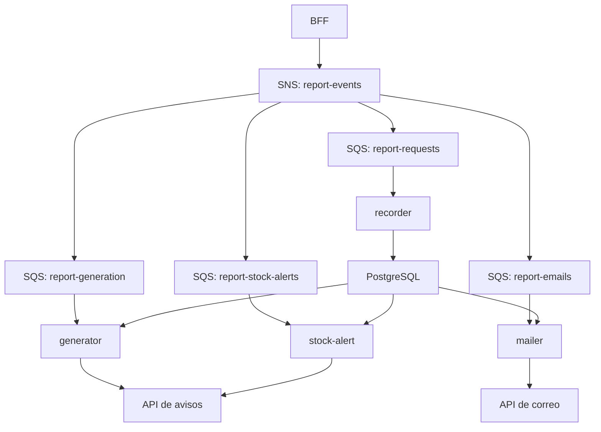

TCGstore — Procesamiento de informes con AWS Lambda
Funciones Node.js que procesan solicitudes de informes de TCGstore de forma asíncrona. El BFF publica eventos en SNS; las suscripciones distribuyen mensajes a colas SQS y estas activan las Lambdas. Los datos se consultan o registran en PostgreSQL de Supabase.
Funciones
Carpeta	Función	Comportamiento
recorder/	report-request-recorder	Registra solicitudes en report_requests.
generator/	report-generator	Consulta hasta diez cartas con mayor precio y publica un aviso en un servicio externo.
stock-alert/	report-stock-alert	Busca cartas con stock bajo y publica un aviso si hay resultados.
mailer/	report-mailer	Envía por API externa un correo HTML con cartas de la rareza configurada, si existen y hay correo válido.

Por defecto, la alerta considera stock igual o inferior a 2 y el correo busca rareza Secreta. El informe generado es texto para un servicio externo de avisos; estas funciones no generan un PDF.
Flujo del evento
1. El BFF publica report.requested en el topic SNS report-events.
2. Las suscripciones filtran por type y entregan el mensaje a las colas correspondientes.
3. Cada cola activa su Lambda. generator también acepta report.regenerate.
4. Las funciones consultan o registran información y, según corresponda, llaman al servicio externo de avisos o correo.
Las funciones esperan que el cuerpo SQS contenga el sobre de SNS con la propiedad Message; la entrega sin procesar (Raw Message Delivery) debe estar desactivada para ese formato. Cada función informa fallos individuales mediante batchItemFailures; configura ReportBatchItemFailures en el trigger SQS para utilizarlos.

SQS puede entregar mensajes más de una vez. El registro usa requestId como clave y ON CONFLICT DO NOTHING para evitar filas duplicadas. Esto no garantiza por sí solo que un aviso o correo externo no se duplique tras un reintento. Las DLQ sirven para revisar mensajes que exceden el límite configurado.
Requisitos
- Node.js y npm para empaquetar; las funciones emplean pg.
- PowerShell, AWS CLI y tar disponibles en Windows.
- PostgreSQL accesible y credenciales temporales AWS o rol con los permisos necesarios.
- Recursos SNS/SQS/Lambda y acceso a las APIs externas para realizar pruebas completas.
Los scripts configuran nodejs22.x para AWS y nodejs20.x para LocalStack; verifica que tu instalación local sea compatible con las dependencias. Los scripts de infraestructura crean o actualizan recursos: revisa cuenta y región antes de ejecutarlos.
Variables de las funciones
Variable	Uso
DATABASE_URL	Cadena de conexión PostgreSQL; utilizada por las cuatro funciones.
NOTICE_URL	Endpoint de avisos para generator y stock-alert.
NOTICE_API_KEY	Clave del servicio de avisos/correo.
EMAIL_URL	Endpoint de correo; mailer tiene un valor predeterminado.
FEATURED_RARITY	Rareza del correo; predeterminado Secreta.
APP_URL	Enlace de la aplicación incluido en el correo.
LOW_STOCK_THRESHOLD	Umbral de alerta; predeterminado 2.
REPORT_TIMEZONE	Zona horaria de los textos; predeterminado America/Santiago.
DATABASE_SSL	false desactiva SSL; por defecto el código habilita SSL con rejectUnauthorized: false.

Configura los valores mediante variables de entorno del despliegue y no subas contraseñas, claves ni credenciales al repositorio. La configuración actual de TLS no verifica el certificado del servidor; debe revisarse para producción.
Preparación de la base de datos
En Supabase, revisa y ejecuta sql/supabase.sql en el SQL Editor para crear report_requests y su índice. El script también activa RLS y consulta cards; la tabla cards debe existir. Usa una cadena PostgreSQL compatible con la conectividad de tus Lambdas.
Empaquetado y despliegue
Desde la raíz del repositorio, en PowerShell:
aws sts get-caller-identity
.\scripts\01-package.ps1
El primer comando permite verificar la cuenta activa. El segundo instala dependencias de producción y genera cuatro ZIP en dist/, uno por función, sin desplegarlos.

Los siguientes scripts realizan acciones sobre el entorno AWS configurado; revisa su contenido y permisos antes de ejecutarlos:
Script	Función
scripts/02-deploy-lambdas.ps1	Crea o actualiza funciones y configuración.
scripts/03-messaging.ps1	Configura topic, colas, suscripciones, DLQ y triggers.
scripts/04-test.ps1	Publica eventos de prueba.
scripts/05-test-email.ps1	Prueba el servicio de correo.

00-config.ps1 es cargado por los demás scripts y define nombres, región y rol para el entorno. Consulta docs/BLOQUE-B.md y docs/DEFENSA.md para el procedimiento de integración y presentación; revisa que sus valores coincidan con tu ambiente antes de aplicarlos.
Verificación del flujo
Solicita un informe desde el frontend como Admin y verifica la respuesta 202. Busca el requestId en logs, confirma su fila en report_requests, revisa los resultados del servicio externo y comprueba las DLQ. La ejecución real depende de la configuración del Gateway, SNS, SQS, permisos, base de datos y APIs externas.
Arquitectura de mensajería

Los cuatro consumidores son independientes: ninguno espera a que termine el anterior. SNS distribuye el evento; SQS lo conserva mientras espera procesamiento. Cada cola principal tiene una DLQ propia, con nombre terminado en -dlq.
Recursos y filtros definidos por los scripts
Cola	Tipos aceptados	Función
report-requests	report.requested	report-request-recorder
report-generation	report.requested, report.regenerate	report-generator
report-stock-alerts	report.requested	report-stock-alert
report-emails	report.requested	report-mailer

La suscripción configura FilterPolicyScope=MessageBody. La política de cada cola autoriza sqs:SendMessage al servicio SNS condicionando el ARN de origen al topic. El trigger configura lotes de cinco mensajes y ReportBatchItemFailures.

Los scripts establecen VisibilityTimeout=90 segundos, maxReceiveCount=3 y retención de DLQ de 14 días. maxReceiveCount limita recepciones antes del traslado a DLQ; no debe interpretarse como garantía de exactamente tres ejecuciones completas del código.
Contrato del mensaje
El contenido publicado en SNS tiene esta forma:
{
  "type": "report.requested",
  "body": {
    "requestId": "solicitud-de-ejemplo",
    "requester": "usuario@example.com",
    "requesterId": "sub-del-usuario",
    "reportType": "top-products",
    "params": {},
    "requestedAt": "2026-10-27T12:00:00Z"
  }
}
En Lambda se recibe un lote SQS: cada record.body contiene el JSON del sobre SNS; dentro de Message está serializado el evento anterior. events/sqs-report-requested.json sirve como muestra de ese envoltorio para invocaciones manuales. Publicar un JSON directamente en SQS sin ese formato no equivale a una entrega SNS compatible.

requestId conecta logs y registro persistido. requester debe contener un email si se espera envío de correo. Con el BFF la identidad se extrae del JWT; el script de prueba utiliza una identidad ficticia y no comprueba el inicio de sesión.
Comportamiento de las funciones
Recorder
Inserta en report_requests el identificador, solicitante, identificador de usuario, tipo, parámetros y fecha de la solicitud. Si el identificador ya existe, ON CONFLICT DO NOTHING evita otra fila. Acepta solo report.requested.
Generator
Consulta cards con precio no nulo, ordena por precio descendente y selecciona hasta diez cartas. Construye un resumen de texto y lo publica mediante POST a NOTICE_URL, con autenticación ApiKey. También procesa report.regenerate, sin producir por ello un nuevo registro en la cola de solicitudes.

El código implementa esta consulta fija; reportType y params no representan un motor genérico de consultas. Los importes se formatean como USD, por lo que debe verificarse que esa unidad corresponda a los datos del catálogo.
Stock alert
Consulta hasta 50 cartas con stock igual o inferior al umbral. Trata stock nulo como cero y prioriza las agotadas, después el menor stock y luego el precio. Si no hay coincidencias, registra esa situación y termina sin publicar aviso.
Mailer
Consulta las cartas de la rareza configurada y prepara un correo HTML con miniaturas y enlace a la aplicación. El destinatario es el solicitante de la petición. Si no hay cartas o no hay un correo válido para el solicitante, no envía un correo. La API externa debe habilitar al usuario y permitir el envío; sus cuotas y disponibilidad se verifican con el proveedor.
Despliegue paso a paso en PowerShell
1. Comprueba cuenta y región de AWS con credenciales vigentes.
2. Prepara la tabla report_requests y comprueba acceso a cards.
3. Empaqueta las cuatro funciones.
4. Despliega código y variables.
5. Conecta mensajería y triggers.
6. Ejecuta una prueba controlada y revisa logs, base y servicios externos.
$env:AWS_REGION = "us-east-1"
aws sts get-caller-identity
.\scripts\01-package.ps1
.\scripts\02-deploy-lambdas.ps1
.\scripts\03-messaging.ps1
Ejecuta cada línea después de comprobar el resultado anterior. El script de despliegue solicita la conexión PostgreSQL y la clave de API; utiliza LabRole en AWS real. No asumas que el rol existe o tiene todos los permisos en cualquier cuenta: esa configuración corresponde al laboratorio. Los permisos de SNS, SQS, CloudWatch Logs y Lambda deben ajustarse al entorno.

El ARN del topic resultante debe configurarse como SNS_TOPIC_ARN en el BFF. Cambiar la configuración local de un script no modifica automáticamente un contenedor BFF que ya esté desplegado.
Pruebas por nivel
Publicación en SNS sin frontend ni BFF
.\scripts\04-test.ps1
.\scripts\04-test.ps1 -Type report.regenerate
La primera prueba activa los cuatro consumidores. La segunda activa solo el generador mediante el filtro. El script muestra logs y cantidades aproximadas de mensajes en las DLQ. No demuestra autenticación de usuario ni permisos HTTP del BFF.

Para probar correo, utiliza un destinatario propio autorizado:
.\scripts\05-test-email.ps1 -To "<tu-correo>"
Esta llamada realiza un envío real si el servicio lo permite. El script SNS usa un solicitante ficticio; para comprobar el correo del usuario autenticado, realiza además la prueba desde React.
Prueba completa desde la aplicación
1. Inicia sesión como Admin.
2. Solicita el informe desde administración y conserva el informeId devuelto por el BFF.
3. Busca el mismo identificador en los logs de las funciones.
4. Comprueba la fila en Supabase:
SELECT id, requester, requester_id, type, requested_at
FROM report_requests
ORDER BY requested_at DESC
LIMIT 10;
5. Revisa el aviso de informe, el de stock si hay coincidencias y el correo si se cumplen sus condiciones.
6. Comprueba si hay mensajes pendientes o fallidos en SQS y las DLQ.
Una fila registrada no prueba que el aviso o correo se haya enviado: cada consumidor necesita su propia evidencia.
Logs y diagnóstico
aws logs tail /aws/lambda/report-generator --since 10m
aws logs tail /aws/lambda/report-request-recorder --since 10m
aws logs tail /aws/lambda/report-stock-alert --since 10m
aws logs tail /aws/lambda/report-mailer --since 10m
Síntoma	Qué comprobar
ExpiredToken	Credenciales de la sesión AWS.
Acceso denegado a recursos	Cuenta, región, rol y políticas.
Error al parsear el mensaje	Envoltorio SNS y Raw Message Delivery.
No llega nada a una cola	Filtro, type, suscripción y política de la cola.
Cola recibe pero Lambda no ejecuta	Trigger habilitado y permisos para SQS.
Error de conexión PostgreSQL	Host, DNS, red, usuario, contraseña y TLS.
Tabla inexistente	Esquema, base correcta y ejecución del SQL.
HTTP 401 en API externa	Clave y cabecera de autenticación.
No hay alerta de stock	Datos del catálogo y umbral.
No hay correo	Email del solicitante, rareza, permisos del servicio y logs.
Avisos repetidos	Entregas repetidas o fallo después del efecto externo.

Las funciones utilizan conexiones PostgreSQL reutilizables y devuelven los identificadores fallidos del lote. Si un servicio externo acepta un envío y después ocurre un error, un reintento puede repetir ese efecto: para garantizar unicidad se necesita un mecanismo adicional de idempotencia.
Estructura y mantenimiento
- recorder/, generator/, stock-alert/, mailer/: código y dependencias de cada función.
- scripts/: configuración, empaquetado, despliegue, mensajería y pruebas.
- sql/: esquema de solicitudes.
- events/: evento de prueba.
- docs/: guía de integración y material de defensa.
- dist/: ZIP generados localmente al empaquetar.
Después de cambiar código, vuelve a empaquetar y desplegar las funciones afectadas. Revisa los filtros y los contratos si cambia la estructura de eventos. No publiques credenciales AWS, DATABASE_URL con contraseña, API keys ni datos personales de pruebas en commits o capturas.
LocalStack y alcance
00-config.ps1 distingue LocalStack por la cuenta 000000000000 y cambia el runtime y rol utilizados. Esto no prepara por sí solo un emulador ni su conectividad: configura previamente el perfil, endpoint y servicios locales. El repositorio no incluye un entorno Docker Compose completo.

Las funciones no garantizan alta disponibilidad de la base ni del proveedor externo, y no implementan un endpoint para que React consulte el resultado final. La configuración y las evidencias del despliegue se mantienen por ambiente.
Repositorios relacionados
- BFF
- Frontend
